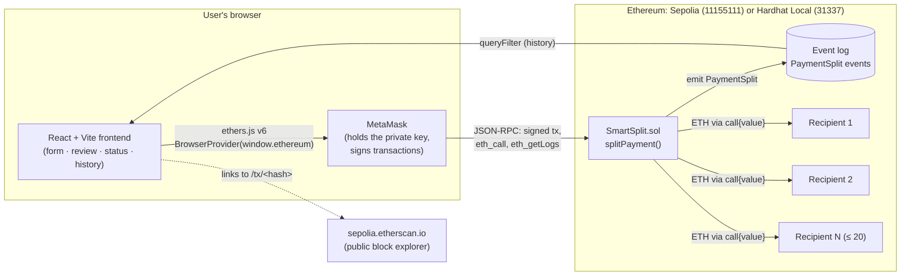
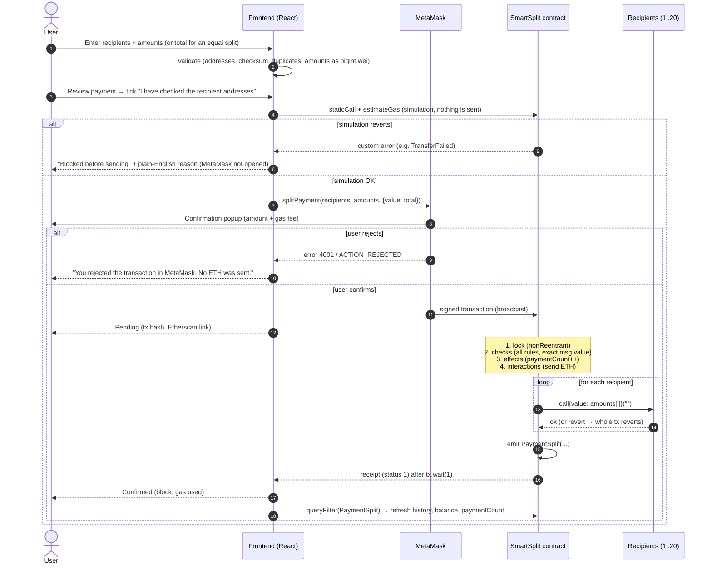
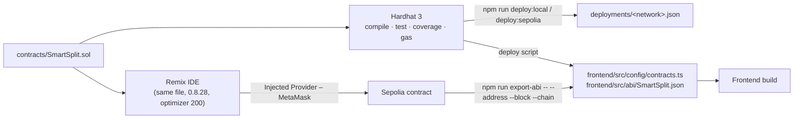

# Smart Split — Architecture

Smart Split has **three parts and no server**:

1. **`SmartSplit.sol`**, a smart contract on Ethereum (Sepolia testnet, or a local Hardhat chain in development). It is the whole "backend": it checks the payment, forwards the ETH and records an event.
2. **A React web app** that builds the payment, checks it, and shows status and history.
3. **MetaMask**, the user's wallet. It holds the private key and signs transactions. The web app never sees the key.

Rendered images of the diagrams below (SVG for screens, PNG for the printed report) are in [`docs/images/`](images/): `architecture-components`, `architecture-sequence`, `architecture-tx-states` and `architecture-dev-flow` (`.svg` / `.png`).

## 1. Components



| Part | Technology | Responsibility |
|---|---|---|
| Smart contract | Solidity 0.8.28 | Validate inputs, forward exact amounts, all-or-nothing, emit `PaymentSplit` |
| Frontend | React 19, Vite 8, TypeScript, Tailwind 4, ethers v6 | Form, validation, review, status, history |
| Wallet | MetaMask | Accounts, network selection, signing, broadcasting |
| Dev tooling | Hardhat 3 (tests, coverage, gas, deploy scripts), Remix IDE (visual demo, Sepolia deployment) | Build, test, deploy |
| History storage | Ethereum event logs | Permanent, public, needs no database |

### Why there is no backend server or database
- The contract **is** the backend logic. Its rules run on every Ethereum node, so nobody (including us) can change them for one user.
- **Events are the database.** Every successful payment emits `PaymentSplit(paymentId, sender, recipients, amounts, total, timestamp)`. The frontend rebuilds the history by querying these logs from the block the contract was deployed in (`deployBlock`).
- Fewer parts to secure and host: there is no server, no API key in the frontend, and no stored user data.

## 2. One payment, step by step



## 3. Contract design in one paragraph

`splitPayment(address[] recipients, uint256[] amounts)` is `payable`. It first takes a simple reentrancy lock. Next it validates **everything**: 1–20 recipients, equal-length arrays, no zero address, not the contract, not the sender, no zero amount, no duplicates, and `msg.value == sum(amounts)` exactly. Then it increments `paymentCount` (effects). Only then does it send each amount with a low-level `call` (interactions). If any send fails, the whole transaction reverts, so either everyone is paid or no one is. Finally it emits `PaymentSplit`. Because `msg.value` must match exactly and everything is forwarded in the same transaction, the contract's balance is always 0. Plain ETH transfers to the contract are rejected (`receive`/`fallback` revert).

## 4. Frontend modules

```
frontend/src/
├── config/contracts.ts      chainId → { address, deployBlock }  (written by deploy/export-abi scripts)
├── config/chains.ts         supported chains, wallet_addEthereumChain params, log chunk size
├── abi/SmartSplit.json      ABI exported from Hardhat
├── lib/                     pure logic, unit-tested with Vitest
│   ├── validation.ts        parseEthAmount, validateAddress, validateForm
│   ├── split.ts             equalSplit (bigint wei, remainder to first recipients), gas upper bound
│   ├── format.ts            ETH/address/time formatting, Etherscan links
│   ├── errors.ts            custom error → plain English; rejection detection
│   ├── chunks.ts            fetchInChunks: getLogs in block ranges, halving on "range too large"
│   └── contract.ts          ABI + ethers Interface
├── hooks/
│   ├── useWallet.ts         connect, silent restore, accountsChanged/chainChanged, switch network, balance
│   ├── useSmartSplit.ts     contract instance, paymentCount, sendPayment state machine, session list
│   ├── usePaymentHistory.ts PaymentSplit events (My / All), chunked
│   └── useAsyncData.ts      async loading keyed by (chain, account, …) so stale data never shows
└── components/              Header, Notices, DashboardCards, PaymentForm, PaymentSummary,
                             ReviewModal, TxStatusPanel, HistoryPanel, CopyButton, ui
```

**Transaction status machine** (`useSmartSplit.sendPayment`):

```mermaid
stateDiagram-v2
    [*] --> idle
    idle --> checking: Confirm in modal
    checking --> failed: simulation reverts (MetaMask not opened)
    checking --> awaiting_signature: simulation OK
    awaiting_signature --> rejected: user rejects (4001)
    awaiting_signature --> pending: tx broadcast (hash known)
    pending --> confirmed: receipt.status == 1
    pending --> failed: reverted / dropped
    confirmed --> idle: Clear / new payment
    failed --> idle
    rejected --> idle
```



"Confirmed" appears **only** after `tx.wait(1)` returns a receipt with `status === 1`.

## 5. Money handling

- Every amount is a `bigint` in **wei** (1 ETH = 10¹⁸ wei). User input is converted only with `ethers.parseEther`. JavaScript floating-point numbers are never used for money (`0.1 + 0.2 !== 0.3` in JS).
- **Equal split:** `share = total / n`, `remainder = total % n`, and the first `remainder` recipients get one extra wei, so the parts add up to exactly `total`. Example: 0.1 ETH / 7 gives five recipients 0.014285714285714286 ETH and two recipients 0.014285714285714285 ETH.

## 6. Development and deployment flow


