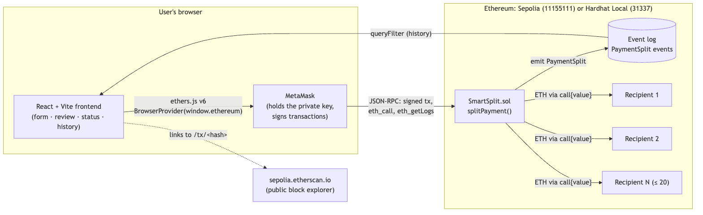
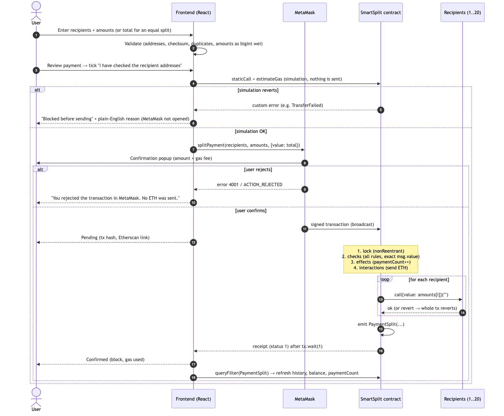
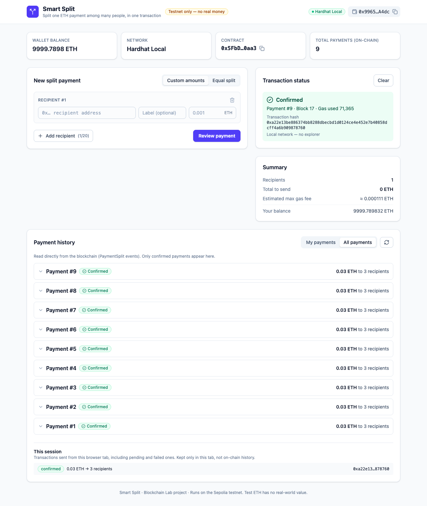

# Smart Split: A Decentralised Application for Splitting One ETH Payment Among Multiple Recipients

**Blockchain Lab Project Report**

| | |
|---|---|
| Student | Om Date |
| Roll number | `<<ROLL NUMBER>>` |
| Course / Lab | `<<COURSE NAME>>` |
| Guide | `<<GUIDE NAME>>` |
| Institution | `<<INSTITUTION>>` |
| Date | `<<SUBMISSION DATE>>` |
| Deployed contract (Sepolia) | `0x3Ff9C193b1Bd228C76Cd4B1ffE36f3D2F97845fC` |

---

## Abstract

Sharing a payment among several people with cryptocurrency normally means sending one transaction per person. Each transaction has to be approved and paid for separately, and a failure part-way leaves the payment incomplete. This project presents **Smart Split**, a decentralised application (dApp) on the Ethereum blockchain that pays up to twenty recipients from **one transaction**. A Solidity smart contract receives the total amount and immediately forwards each recipient's share. If any transfer fails, the entire transaction is reverted, so the payment is **atomic**: everyone is paid or no one is. The contract validates every input, requires the attached ETH to equal the sum of the shares exactly (so it never holds funds), follows the checks-effects-interactions pattern and uses a reentrancy lock. Every successful payment emits an event, and the web front end, built with React, TypeScript and ethers.js, uses these events as its transaction history, so no server or database is needed. The contract was developed and tested with Hardhat (30 automated tests, 100% line coverage of the contract) and demonstrated and deployed with Remix IDE and MetaMask on the Sepolia test network. On a local chain a payment uses about 52,000 gas for one recipient and 322,000 for twenty. Sepolia's newer gas rules make state creation considerably more expensive there.

**Keywords:** Ethereum, smart contract, Solidity, dApp, payment splitting, atomicity, reentrancy, MetaMask, Hardhat, Remix, Sepolia.

---

## 1. Introduction

Blockchains such as Ethereum let people transfer value directly, without a bank. Ethereum adds **smart contracts**: programs stored on the blockchain that anyone can call and that run identically on every node. Because their behaviour is fixed and public, smart contracts can enforce rules that would otherwise need a trusted middleman.

A common real-world need is **splitting a payment**: sharing a restaurant bill, paying a group of freelancers, or distributing prize money. On Ethereum this normally means *N* separate transfers. Smart Split replaces them with a single contract call that sends everyone their share in one atomic transaction.

This report describes the problem, the objectives, the relevant background, the system's architecture, its implementation and security measures, the testing results, and its limitations and possible extensions.

## 2. Problem Statement

Paying *N* people with plain ETH transfers has four problems:

1. **Effort:** the payer must approve *N* separate transactions in their wallet.
2. **Partial failure:** if transfer *k* fails (wrong network, insufficient balance, a recipient that rejects ETH), recipients 1 … *k*−1 are paid and the rest are not, leaving an inconsistent state that has to be fixed by hand.
3. **Cost:** every Ethereum transaction pays a fixed base cost of 21,000 gas, so *N* transactions pay it *N* times.
4. **Record keeping:** there is no single record saying "these *N* transfers were one payment".

Mistakes are also costly: blockchain payments are irreversible, so paying a wrong or mistyped address cannot be undone.

**Goal:** build a simple, explainable dApp that pays several recipients exactly the intended amounts in one atomic transaction, guards against common input mistakes, and keeps a verifiable history, without any centralised server.

## 3. Objectives

1. Write a Solidity smart contract that splits `msg.value` among 1–20 recipients in a single transaction, **all-or-nothing**.
2. Validate inputs on-chain: non-empty, at most 20, equal-length lists, no zero address, not the contract, not the sender, no zero amounts, no duplicates, and **exact** value.
3. Apply standard security practice: checks-effects-interactions, a reentrancy guard, `call` with result checking, rejection of direct ETH, no owner and no stored funds.
4. Record each payment as an on-chain **event** and use the events as the application's history.
5. Build a web interface with wallet connection, network checks, live validation, an equal-split mode, a review step, transaction status, and history.
6. Test thoroughly: automated contract tests with at least 95% line coverage, gas measurements, frontend unit tests, and manual tests on a local chain and on Sepolia.
7. Use **Hardhat** for engineering and **Remix IDE** for visual demonstration and wallet-signed deployment.

## 4. Background

### 4.1 Blockchain
A blockchain is an append-only ledger replicated across many computers (nodes). Transactions are grouped into blocks; each block contains the cryptographic hash of the previous block, so altering history would require recomputing every later block and convincing the network to accept it. A consensus protocol (proof-of-stake on Ethereum today) decides which block is added next, so no single party controls the ledger.

### 4.2 Ethereum and the EVM
Ethereum is a blockchain with a built-in virtual machine, the **Ethereum Virtual Machine (EVM)**. It has two kinds of accounts: *externally owned accounts* (controlled by a private key, e.g. a MetaMask wallet) and *contract accounts* (controlled by their code). The currency is **ether (ETH)**; the smallest unit is **wei**, with 1 ETH = 10¹⁸ wei.

### 4.3 Smart contracts and Solidity
A smart contract is code deployed at an address on the blockchain. **Solidity** is the main high-level language for the EVM. Key concepts used in this project: `payable` functions (can receive ETH), `msg.sender` (the caller), `msg.value` (the wei sent), **events** (logs for off-chain consumers), **custom errors** (typed revert reasons) and **revert** (undoes all effects of a transaction).

### 4.4 Gas
Every EVM operation costs **gas**. The sender pays `gas used × gas price` in ETH. Gas prevents infinite loops, prices computation and storage, and limits how much work fits in one block.

### 4.5 Testnets
A testnet is a public Ethereum network whose ETH has no monetary value. **Sepolia** (chain ID 11155111) is the recommended Ethereum application testnet. Developers can also run a **local** chain (Hardhat Network, chain ID 31337) for instant, free testing.

### 4.6 Wallets
A wallet such as **MetaMask** stores the user's private key and signs transactions. Web applications talk to it through the EIP-1193 `window.ethereum` interface: the app proposes a transaction, MetaMask shows it to the user, signs it internally on approval and broadcasts it. **The private key never leaves the wallet.**

### 4.7 Related approaches
Payment splitting can also use the **pull pattern** (the contract records each recipient's balance and recipients withdraw later), as in OpenZeppelin's `PaymentSplitter` for fixed shareholders. That suits recurring revenue sharing among a fixed group. Smart Split targets one-off payments to an arbitrary list, so it uses the simpler **push** pattern with all-or-nothing semantics (see §8 and §10).

## 5. System Architecture

The system has three parts and no server (Figure 1):

- **Smart contract** `SmartSplit.sol`, deployed on Sepolia (or a local Hardhat chain in development): validation, transfers, events.
- **Web front end** (React + TypeScript), running in the user's browser: input, validation, review, status and history.
- **MetaMask**: key storage, signing and network access.


*Figure 1. Components. The front end reads and writes only through MetaMask; payment history comes from the contract's event log.*

Figure 2 shows the life of one payment, from input to confirmation and history refresh.


*Figure 2. Sequence of one payment, including the pre-send simulation and the rejection path.*

**Why no backend?** The contract enforces the rules, and the blockchain stores every payment permanently as `PaymentSplit` events. The front end rebuilds the history by querying these events. There is no server to host or secure and no personal data stored.

## 6. Methodology and Tools

| Tool | Version | Use |
|---|---|---|
| Solidity | 0.8.28 (exact pin), optimizer on, 200 runs | Contract language |
| Hardhat | 3.19.0 + Mocha/Chai/ethers toolbox | Compilation, 30 automated tests, built-in coverage and gas statistics, deployment scripts, ABI export |
| Remix IDE | browser | Visual compile/deploy/call demo, Sepolia deployment through MetaMask, "At Address" interaction |
| React / Vite / TypeScript | 19 / 8 / strict | Front end |
| Tailwind CSS | 4 | Styling |
| ethers.js | 6.17 | Blockchain library (contract calls, ABI decoding, bigint units) |
| Vitest | 5 | Front-end unit tests |
| MetaMask | browser extension | Wallet |
| Node.js | 22 LTS | Tooling runtime |

**Process.** The work followed phases: (1) scaffold; (2) contract and tests, iterated until all tests passed without weakening any; (3) deployment and demo scripts verified on a local node; (4) front end with unit tests, type checking, lint, build and a browser smoke test against the local chain; (5) documentation; (6) Sepolia deployment and manual testing; (7) a final clean-install check. Deviations from the original specification are recorded in `docs/DECISIONS.md`.

## 7. Implementation

### 7.1 Contract interface

```solidity
uint256 public constant MAX_RECIPIENTS = 20;
uint256 public paymentCount;   // also the payment ID

event PaymentSplit(uint256 indexed paymentId, address indexed sender,
                   address[] recipients, uint256[] amounts,
                   uint256 total, uint256 timestamp);

function splitPayment(address[] calldata recipients, uint256[] calldata amounts)
    external payable nonReentrant;
```

`paymentId` and `sender` are `indexed`, so clients can filter events cheaply (e.g. "my payments").

### 7.2 Validation (checks)

```solidity
if (count == 0) revert NoRecipients();
if (count > MAX_RECIPIENTS) revert TooManyRecipients(count, MAX_RECIPIENTS);
if (count != amounts.length) revert LengthMismatch(count, amounts.length);

for (uint256 i = 0; i < count; i++) {
    address recipient = recipients[i];
    if (recipient == address(0)) revert ZeroAddress(i);
    if (recipient == address(this)) revert ContractAsRecipient(i);
    if (recipient == msg.sender) revert SenderAsRecipient(i);
    if (amounts[i] == 0) revert ZeroAmount(i);
    for (uint256 j = 0; j < i; j++) {
        if (recipients[j] == recipient) revert DuplicateRecipient(recipient);
    }
    required += amounts[i];
}
if (msg.value != required) revert IncorrectValue(msg.value, required);
```

Twelve **custom errors** carry structured data (for example, the index of the faulty entry). They are cheaper than revert strings, and the front end decodes them into plain English.

### 7.3 Effects, interactions and event

```solidity
uint256 paymentId = ++paymentCount;

for (uint256 i = 0; i < count; i++) {
    (bool ok, ) = recipients[i].call{value: amounts[i]}("");
    if (!ok) revert TransferFailed(recipients[i], amounts[i]);
}

emit PaymentSplit(paymentId, msg.sender, recipients, amounts, msg.value, block.timestamp);
```

### 7.4 Reentrancy guard and direct-payment rejection

```solidity
modifier nonReentrant() {
    if (locked) revert ReentrantCall();
    locked = true;
    _;
    locked = false;
}

receive() external payable  { revert DirectPaymentNotAccepted(); }
fallback() external payable { revert DirectPaymentNotAccepted(); }
```

The contract has **no imports**, so it compiles in Remix by pasting the single file, and it has **no owner, no admin functions, no fees and no upgrade mechanism**.

### 7.5 Front-end modules

| Module | Responsibility |
|---|---|
| `lib/validation.ts` | Parses ETH input into wei **with `parseEther` only**: rejects empty, negative, scientific notation and more than 18 decimals. Validates addresses including the **EIP-55 checksum**, the zero address, the contract and the sender, plus case-insensitive duplicates. |
| `lib/split.ts` | Equal split in integer wei: `share = total / n`, `remainder = total % n`; the first `remainder` recipients get +1 wei, so the parts sum exactly to the total. |
| `lib/errors.ts` | Decodes contract custom errors from revert data (including MetaMask's nested error format) into human messages. Detects user rejection (code 4001 / `ACTION_REJECTED`). |
| `lib/chunks.ts` | Loads event logs in block ranges (default 5,000) and halves the range when the RPC replies "range too large". |
| `hooks/useWallet.ts` | Connects only on a button click, restores silently with `eth_accounts`, reacts to `accountsChanged`/`chainChanged` without reloading, switches/adds networks, reads the balance. |
| `hooks/useSmartSplit.ts` | Transaction state machine: *checking* (simulation with `staticCall` + `estimateGas`; a revert is explained without opening MetaMask) → *awaiting signature* → *pending* (hash) → *confirmed* (only when `receipt.status === 1`), *failed* or *rejected*. |
| `hooks/usePaymentHistory.ts` | `PaymentSplit` events from the deployment block, "My payments" (indexed sender) or "All payments". |
| `components/ReviewModal.tsx` | Lists every full checksummed address and amount, the network and the contract. A checkbox, "I have checked the recipient addresses", must be ticked before "Confirm in MetaMask" is enabled. |

The user interface (Figure 3) has a header with the network badge and wallet, dashboard cards (balance, network, contract, total payments), the payment form beside the status and summary panels, and the history below. On mobile it collapses to one column.


*Figure 3. Smart Split after a confirmed 3-recipient payment on the local Hardhat chain.*

## 8. Security Considerations

| Threat / risk | Measure in Smart Split |
|---|---|
| **Reentrancy:** a recipient contract calls back into `splitPayment` during the transfer | (1) Checks-effects-interactions ordering; (2) the `nonReentrant` lock; (3) the contract never holds a balance and each call must bring its own exact ETH, so there is nothing to drain. Tested with a malicious `ReentrantReceiver`. |
| **ETH stuck in the contract** | `msg.value` must **exactly** equal the sum of the amounts; `receive`/`fallback` revert. The contract balance is verified to stay 0. |
| **Partial payment** | Any failed `call` reverts the whole transaction (**atomicity**). Tested with a rejecting recipient placed in the middle of the list: no balance changes. |
| **Recipients that are smart-contract wallets** | `call` forwards enough gas; `transfer`/`send` (2,300 gas) would fail. Tested with `GasHeavyReceiver`, including a contrast test where `transfer` fails. |
| **Input mistakes** (zero address, self, duplicates, zero amounts, wrong totals) | Enforced on-chain with custom errors **and** pre-checked in the UI. |
| **Paying an unintended address** | EIP-55 checksum validation, a review modal with full addresses, a mandatory confirmation checkbox, and MetaMask's own confirmation. |
| **Gas exhaustion / unbounded loops** | At most 20 recipients: worst case about 822k gas, far below the block gas limit. |
| **Floating-point money errors** | All front-end amounts are `bigint` wei; `parseEther` is the only parser. |
| **Key handling** | Keys stay in MetaMask. The recommended Sepolia deployment is through Remix + MetaMask. The Hardhat option uses an encrypted keystore or a git-ignored `.env` holding a *throwaway* key. No secrets are committed. |
| **Privileged roles** | None: no owner, no admin, no upgrade proxy, no fees. |

## 9. Testing and Results

### 9.1 Contract tests (Hardhat)
**30 tests, all passing.** They are grouped as deployment (3); successful splits (7): 1 recipient, 3 equal, unequal, exactly 20, exact event arguments, counter increments, zero contract balance; validation reverts (13): every custom error with its arguments, including non-adjacent duplicates and value too low/too high/zero; atomic failure (1); reentrancy (1); direct ETH (2); smart-contract-wallet recipient (2); and gas sanity (1).

**Coverage:** `SmartSplit.sol` **100% lines, 100% statements** (target ≥ 95%).

### 9.2 Gas measurements

| Recipients | Gas (existing recipient accounts) | Gas (new, empty recipient accounts) |
|---:|---:|---:|
| 1 | 51,862 | 87,027 |
| 3 | 70,876 | 143,694 |
| 10 | 161,877 | 411,877 |
| 20 | 321,925 | 821,925 |

Deployment: **426,320 gas** locally; runtime bytecode **1,725 bytes**. Cost grows roughly linearly with the number of recipients. Paying a never-used address adds the EVM's 25,000-gas account-creation charge.

**Sepolia differs.** The local chain uses the `cancun` gas rules, while Sepolia runs a newer network upgrade (activated 6 Oct 2026) that charges much more for creating state (new storage slots, new accounts, contract code). The same bytecode cost **2,875,494 gas** to deploy on Sepolia. `eth_estimateGas` on the live contract gives about 260k gas for 1 existing recipient, 449k for 1 brand-new recipient, 852k for 3 new and 4.27M for 20 new. That is still far below Sepolia's 200M block gas limit. The contract logic is unchanged; only the network's prices differ.

### 9.3 Local end-to-end demonstration
On a local Hardhat node, `npm run demo:local` split 0.03 ETH among three accounts in one transaction (86,394 gas). Each recipient's balance increased by exactly 0.01 ETH, the sender's decreased by exactly 0.03 ETH plus the gas fee, and the contract's balance remained 0. The script checks these equations automatically.

### 9.4 Front-end tests
**44 Vitest unit tests** pass (validation, equal split, formatting, error decoding, chunked log loading). TypeScript strict mode reports 0 errors, lint reports 0 warnings, and the production build succeeds. A headless-browser smoke test against the local chain passed **26/26 checks**, including validation messages, the review gate, confirmation, exact on-chain balance changes, history refresh, the rejection message, pre-send error decoding and mobile layout. It also found and helped fix two bugs (a stale block number when refreshing history, and text overflow on mobile).

### 9.5 Sepolia results

| Item | Value |
|---|---|
| Contract address | [`0x3Ff9C193b1Bd228C76Cd4B1ffE36f3D2F97845fC`](https://sepolia.etherscan.io/address/0x3Ff9C193b1Bd228C76Cd4B1ffE36f3D2F97845fC) |
| Deployment transaction | [`0x6c73c4302d7043720142bcd0287006742904aaaa95ce1990955ea72eb9460ec6`](https://sepolia.etherscan.io/tx/0x6c73c4302d7043720142bcd0287006742904aaaa95ce1990955ea72eb9460ec6), block 11904281, 2,875,494 gas (0.0043 Sepolia ETH) |
| Payment: 1 recipient, 0.001 ETH | `<<FILL AFTER DEPLOY>>` |
| Payment: 3-way equal split, 0.003 ETH | `<<FILL AFTER DEPLOY>>` |
| Duplicate address blocked in UI | `<<FILL AFTER DEPLOY>>` |
| Rejection in MetaMask handled | `<<FILL AFTER DEPLOY>>` |

Full outputs: `docs/TEST_RESULTS.md`.

## 10. Limitations

1. **At most 20 recipients** per payment (a deliberate gas bound).
2. **All-or-nothing:** one recipient that cannot receive ETH blocks the whole payment. This is safe, but it is less flexible than the pull pattern.
3. **Gas grows linearly** with the number of recipients, and on mainnet it would cost real money.
4. **Testnet only:** not audited and not intended for real funds.
5. **Labels are not persisted:** recipient nicknames exist only in the browser form, never on-chain or in storage.
6. **No privacy:** everything (sender, recipients, amounts) is public on the blockchain.
7. **ETH only:** no ERC-20 tokens.

## 11. Future Scope

- **Pull-payment variant:** record balances and let recipients withdraw, so one bad recipient cannot block others.
- **ERC-20 token support:** split stablecoins such as USDC using `transferFrom` after an approval.
- **Recurring splits:** scheduled payments, for example monthly rent shares.
- **Layer-2 deployment** (Optimism, Arbitrum, Base) for much lower fees.
- Address book and ENS name support, and percentage-based splits.

## 12. Conclusion

Smart Split shows how a small, carefully designed smart contract can replace several error-prone manual transfers with one atomic, verifiable transaction. The design favours simplicity and explainability: push payments, exact-value checks, checks-effects-interactions, a reentrancy lock, and no owner or stored funds. Using contract events as the history removes the need for a backend. Automated tests (30 contract tests with 100% line coverage, 44 front-end unit tests), measured gas figures and an end-to-end local demonstration give confidence in the implementation. Combining Hardhat for engineering with Remix and MetaMask for demonstration and deployment covers both the development and the user-facing sides of a dApp.

## References

1. G. Wood, *Ethereum: A Secure Decentralised Generalised Transaction Ledger* (Yellow Paper). https://ethereum.github.io/yellowpaper/paper.pdf
2. Ethereum Foundation, *Ethereum Developer Documentation*. https://ethereum.org/en/developers/docs/
3. Solidity Team, *Solidity Documentation, v0.8.28*. https://docs.soliditylang.org/en/v0.8.28/
4. Solidity Documentation, *Security Considerations* (reentrancy, checks-effects-interactions, sending Ether). https://docs.soliditylang.org/en/v0.8.28/security-considerations.html
5. Nomic Foundation, *Hardhat 3 Documentation*. https://hardhat.org/docs
6. Remix Project, *Remix IDE Documentation*. https://remix-ide.readthedocs.io/
7. R. Moore, *ethers.js v6 Documentation*. https://docs.ethers.org/v6/
8. MetaMask, *Ethereum Provider API (EIP-1193)*. https://docs.metamask.io/wallet/reference/provider-api/
9. V. Buterin, A. Van de Sande, *EIP-55: Mixed-case checksum address encoding*. https://eips.ethereum.org/EIPS/eip-55
10. F. Vogelsteller et al., *EIP-1193: Ethereum Provider JavaScript API*. https://eips.ethereum.org/EIPS/eip-1193
11. OpenZeppelin, *Payment splitter and pull-payment patterns* (documentation). https://docs.openzeppelin.com/contracts/
12. Ethereum Foundation, *Networks: Sepolia testnet*. https://ethereum.org/en/developers/docs/networks/
